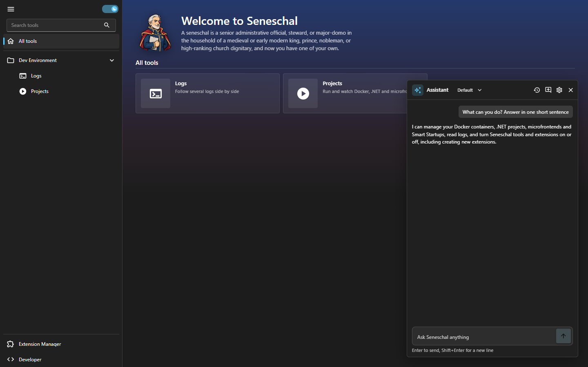
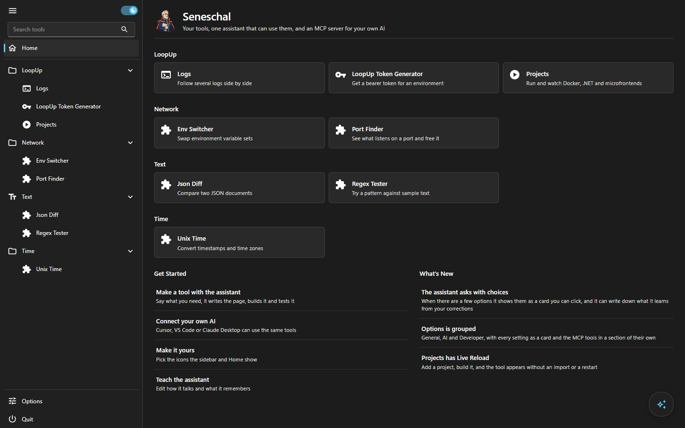
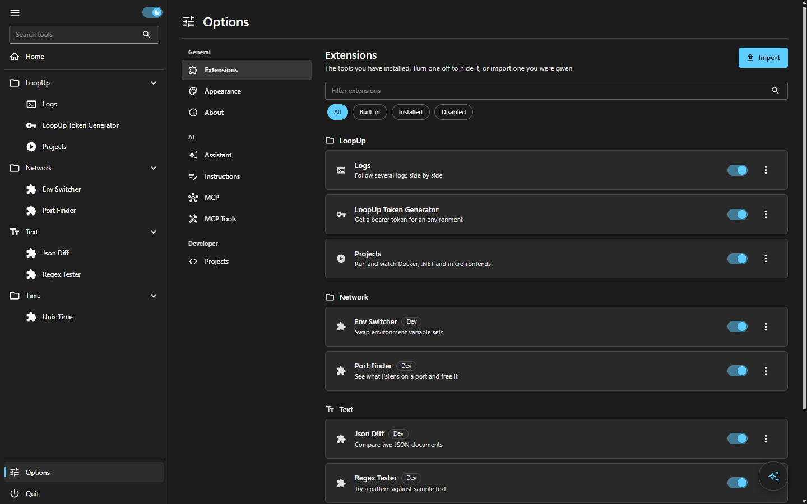
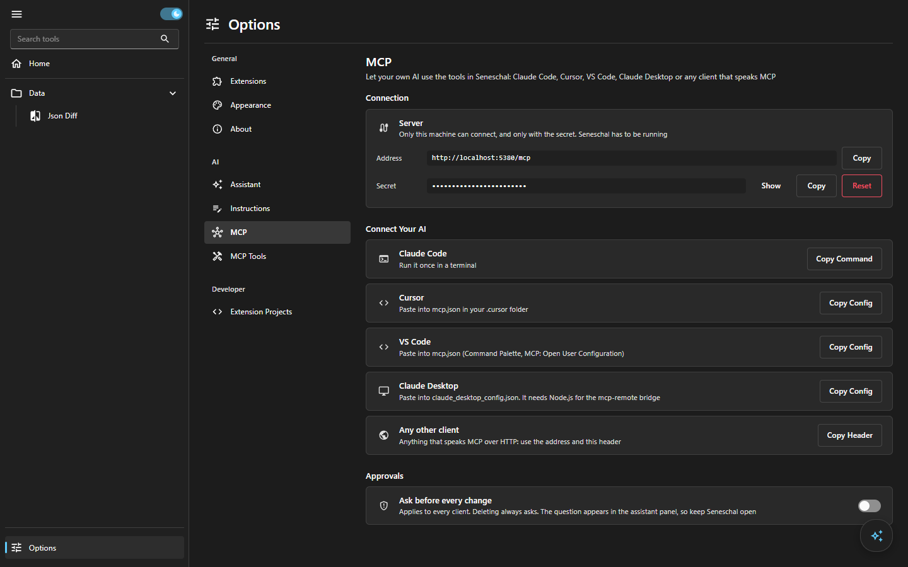
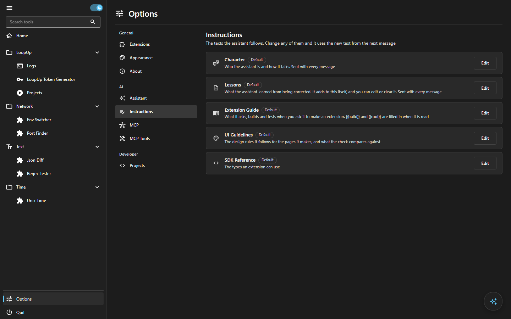
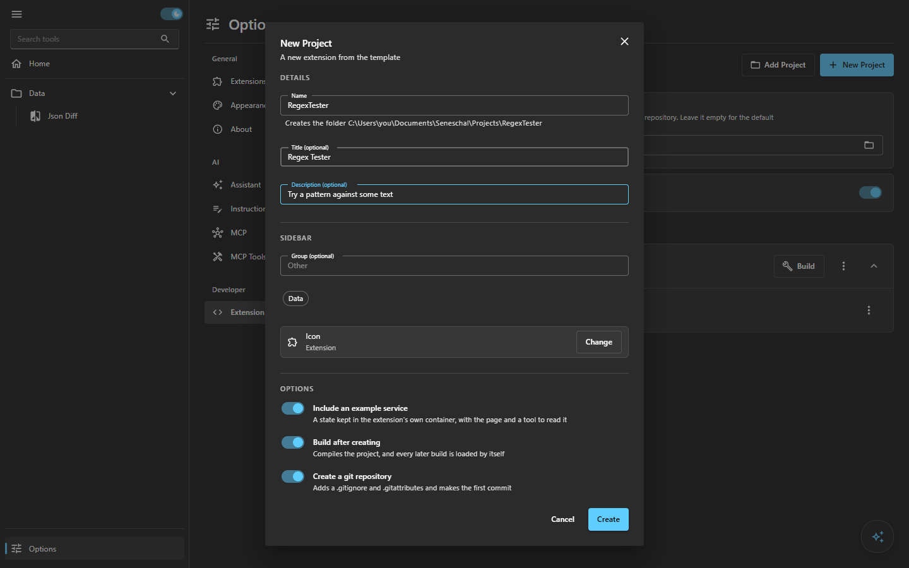
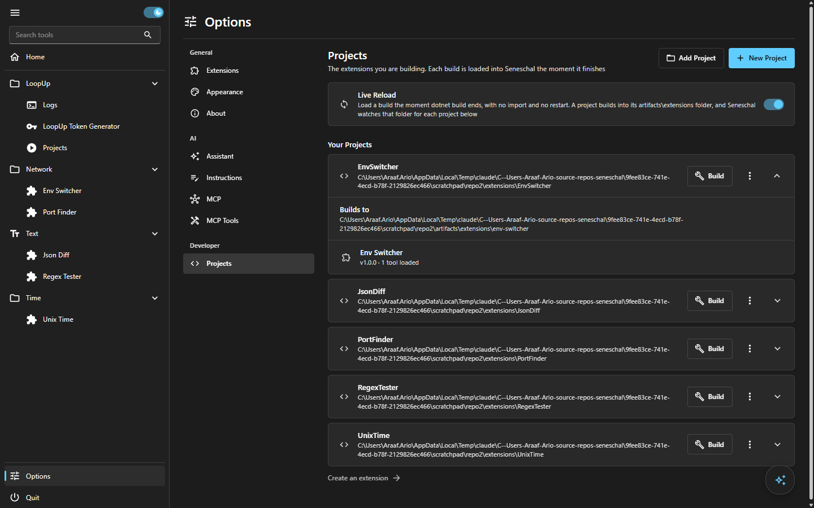

<p align="center">
  
</p>

<h1 align="center">Seneschal</h1>

<p align="center">
  <b>The small tools of your day, in one place on your own machine.</b><br>
  Ask Claude to build the ones you are missing. Every tool is also open to your own AI through MCP.
</p>

<p align="center">
  <a href="https://github.com/araafario/seneschal/releases"></a>
  <a href="https://github.com/araafario/seneschal/actions/workflows/ci.yml"></a>
  
  
  
</p>

<p align="center">
  <a href="#install">Install</a> &nbsp;·&nbsp;
  <a href="#does-this-sound-like-your-week">Why</a> &nbsp;·&nbsp;
  <a href="#how-it-works">How it works</a> &nbsp;·&nbsp;
  <a href="#claude-and-mcp">Claude and MCP</a> &nbsp;·&nbsp;
  <a href="#make-your-own-tool">Make a tool</a> &nbsp;·&nbsp;
  <a href="#documentation">Docs</a>
</p>

<p align="center">
  
</p>

## Does this sound like your week

- **Your tools are scattered.** A script in a gist, a note with the right `docker` flags, three terminals, a bookmark for the token page. Seneschal gives each one a page in one sidebar.
- **You keep forgetting the command.** You know what you want to do and not how to spell it. A button with a label is easier to find than a line in your shell history.
- **You want a tool and you cannot be bothered to build the UI.** Say what you need. The assistant writes the page, builds it, checks it against the design rules and loads it while you watch.
- **You use more than one AI.** Claude Code in the terminal, Cursor in the editor, Claude Desktop for the rest. Every tool you add is an MCP tool, so all of them can use it, and none of them needs its own copy.
- **You would like your AI to do the boring part, but not unsupervised.** Anything that deletes or overwrites asks you first, in a card you can see.
- **You are tired of tools that want an account.** Seneschal runs on your machine. Your tokens, containers and source stay there.

## How it works

Seneschal is a frame: a sidebar, a search, Options, an assistant and an MCP server. It ships with no tools on purpose. Every tool is an **extension** you import, build or ask for, and remove when you stop needing it.

<table>
<tr>
<td width="50%"></td>
<td width="50%"></td>
</tr>
<tr>
<td><sub><b>Home.</b> Your tools by group, favorites on top, and a short list to get started.</sub></td>
<td><sub><b>Extensions.</b> Turn a tool off to hide it. Import one you were given.</sub></td>
</tr>
</table>

A few things you will notice:

- **Nothing to restart.** An extension loads, updates and unloads live.
- **Keyboard first.** `Ctrl+K` goes to the search, `Ctrl+J` to the assistant, `Esc` closes any dialog.
- **Light and dark**, and a sidebar that becomes a rail in a narrow window.
- **Small on purpose.** Short labels, no decoration, one accent color. The [UI guidelines](docs/ui-guidelines.md) say what it avoids and why.

## Claude and MCP

<table>
<tr>
<td width="50%"></td>
<td width="50%"></td>
</tr>
<tr>
<td><sub><b>MCP.</b> The address, the secret, and a setup to paste for Claude Code, Cursor, VS Code and Claude Desktop.</sub></td>
<td><sub><b>Instructions.</b> Read and edit how the assistant talks and what it has learned.</sub></td>
</tr>
</table>

- **An assistant on every page.** It runs the Claude Code you already have signed in, so there is no extra account or key.
- **It asks with choices.** When there are a few clear options it shows them as a card you click, instead of a question you have to answer in words.
- **It learns.** When you correct it, it writes one line to a list of lessons that you can read and edit. It can also edit its own character, and you are asked before it does.
- **An MCP server.** Every tool is offered at `http://localhost:5380/mcp`, to the built-in assistant and to any client you connect. A tool that is turned off is not offered.
- **Every feature is a tool.** What you can click, Claude can do. An extension adds its tools with one interface.
- **It asks before it deletes.** Anything that removes or overwrites is marked, and Claude waits for your answer.

You can say:

- *Help me create a tool that compares two JSON files*
- *Which tools do I have turned on, and which do I never open?*
- *Show me the last errors in my logs*
- *Start the stack I use on Mondays*

See [the assistant guide](docs/assistant.md) for models, history, safety and using Seneschal from your own Claude Code.

## Make your own tool

Three ways, from least to most work:

1. **Ask.** Open the assistant and choose *Help me create a new extension*. It asks what the tool should do, writes it, builds it, checks it and loads it.
2. **Start from a template.** Options, Projects, *New Project*, or `seneschal extension new <Name>`. You get a complete project that already builds.
3. **Write it.** An extension is a class, a Blazor page and a manifest, built against the [`Seneschal.Sdk`](src/Seneschal.Sdk/README.md) package.

<table>
<tr>
<td width="50%"></td>
<td width="50%"></td>
</tr>
<tr>
<td><sub><b>New Project.</b> A name, a group, an icon.</sub></td>
<td><sub><b>Projects.</b> Build, and the tool is in the sidebar. With Live Reload on, every build is loaded the moment it ends.</sub></td>
</tr>
</table>

Share it as one `.snx` file. Someone else imports it in Options, and it is theirs.

## Install

On Windows, in PowerShell:

```powershell
irm https://raw.githubusercontent.com/araafario/seneschal/main/install.ps1 | iex
```

That installs it for you alone, with no administrator rights, together with the .NET SDK so you can make your own tools without Visual Studio (add `-NoDev` for a lite install, see the [install guide](docs/install.md)). Then open **Seneschal** from the Start menu, or type `seneschal` in a terminal.

It runs quietly in the background. There is no console window to keep open, and `seneschal stop` closes it. `seneschal doctor` checks that everything it needs is in place and says what to fix.

## Questions

**Does anything leave my machine?** No. Seneschal listens on `localhost` and every MCP call needs a secret that only you have. The assistant uses the Claude Code you already run, so what you say to it goes where Claude Code sends it and nowhere else.

**Do I need Claude Code?** No. Without it the assistant panel cannot answer, but the tools, the MCP server and the setup for any other MCP client all work.

**Is an extension safe?** An extension runs with full access to your machine, like any program you install. Import only the ones you trust. Seneschal asks you to confirm every import.

**Windows only?** For now. It is .NET and Blazor, so the core is portable, but the installer, the launcher and the shell integration are Windows.

## Documentation

| | |
| --- | --- |
| [Install guide](docs/install.md) | Installing, updating, removing, the `seneschal` command, and when something does not start |
| [The assistant](docs/assistant.md) | How it works, models, history, lessons, safety, and using Seneschal from your own Claude Code |
| [Building extensions](docs/extensions.md) | What an extension is, where Seneschal finds them, and how to make one |
| [Developing Seneschal](docs/development.md) | Running from source, the project layout, testing safely, and making a release |
| [UI guidelines](docs/ui-guidelines.md) | How everything looks, reads and behaves, and the list of things it avoids |
| [Quality notes](docs/qa) | The plans used to audit the UI and test the behavior, and what lacks |
| [Extension SDK](src/Seneschal.Sdk/README.md) &nbsp;·&nbsp; [The app](src/Seneschal.Host/README.md) | Module references |

<br>

<p align="center">
  <sub>Built for the person who does the same ten things every day. Windows first, built with .NET 10 and Blazor.</sub>
</p>
